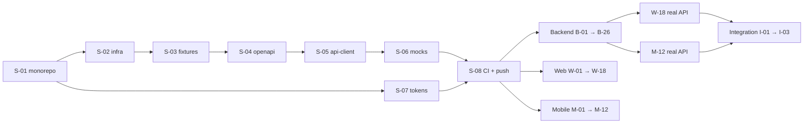

# Roadmap — PayProof MVP (P0)

## Track-lər
| Kod | Track | Sahib | Step faylı |
|---|---|---|---|
| S | Shared / Foundation | lead | `steps/shared.md` |
| B | Backend (`apps/api`) | lead | `steps/backend.md` |
| W | Web (`apps/web`) | lead | `steps/web.md` |
| M | Mobile (`apps/mobile`) | mobil komanda yoldaşı | `steps/mobile.md` |
| I | Integration / demo | hamı | `steps/integration.md` |

## Mərhələlər (milestones)
| Milestone | Nəticə | Step-lər |
|---|---|---|
| **M0 · Foundation** | Monorepo, infra, fixtures, API müqaviləsi, client, mock-lar, tokenlər, CI | S-01 … S-08 |
| **M1 · Oxuma dikey kəsiyi** | Seed data API-dən gəlir; qayda mühərriki golden test-dən keçir; dashboard, siyahı, detal (mock ilə) veb və mobildə | B-01…B-12 · W-01…W-09 · M-01…M-07 |
| **M2 · Əsas axın** | Yükləmə → çıxarış → əlaqə → yoxlama → tapşırıq → düzəliş → yenidən yoxlama | B-13…B-19 · W-10…W-12 · M-08 |
| **M3 · Təsdiq, ixrac, audit** | Versiyaya bağlı təsdiq, idempotent ixrac, audit, qaydalar, bildirişlər | B-20…B-24 · W-13…W-16 · M-09…M-10 |
| **M4 · Keyfiyyət** | E2E, a11y, PWA, real API-yə keçid | W-17, W-18 · M-11, M-12 · B-26 |
| **M5 · Demo hazırlığı** | Real stack-də tam axın, demo sıfırlama, v0.1.0 | B-25 (stretch) · I-01 … I-03 |

## Asılılıq qrafı (qısa)

Track daxilində step-lər əsasən ardıcıldır; dəqiq asılılıq hər step-in "Asılılıq" sətrindədir.

## Paralel iş planı (tövsiyə)
| Dövr | Lead — sessiya 1 | Lead — sessiya 2 | Komanda yoldaşı |
|---|---|---|---|
| 1 | S-01 … S-08 (ardıcıl) | — | Prototipi və sənədləri oxumaq, alətləri qurmaq |
| 2 | B-01 … B-06 | W-01 … W-05 | M-01 … M-04 |
| 3 | B-07 … B-12 | W-06 … W-09 | M-05 … M-07 |
| 4 | B-13 … B-19 | W-10 … W-12 | M-08 |
| 5 | B-20 … B-24, B-26 | W-13 … W-17 | M-09 … M-11 |
| 6 | B-25 (stretch) | W-18 | M-12 |
| 7 | I-01 … I-03 — birlikdə | | |

## Scope sərhədi
P0-a daxil deyil (step yaratmayın): ERP inteqrasiyası, müqavilədən AI ilə qayda çıxarışı, qismən çatdırılma, müştəri portalı, push bildirişləri, ödəniş statusu, kütləvi təsdiq, native mobil. Bunlar `Gələcək` bölməsindədir və UI-də "Tezliklə" kimi göstərilə bilər.

## Gələcək (P1/P2) — yalnız istiqamət
- P1: bir ERP/mühasibat connector-u (oxuma), müqavilə şərtlərinin AI ilə çıxarışı + insan təsdiqi, çoxsaylı təhvil/qismən çatdırılma, faktiki ödəniş məlumatı ilə ölçmə.
- P2: Web Push, statusun ERP-yə geri yazılması, müştəri portalları, çoxölkəli qayda paketləri, native mobil (ehtiyac sübut olunsa).
